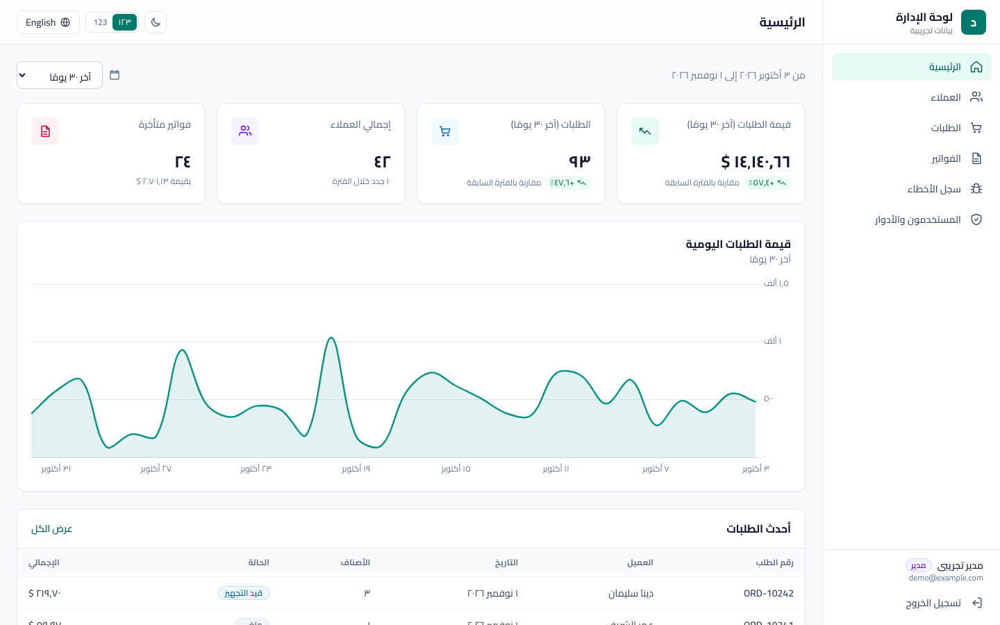
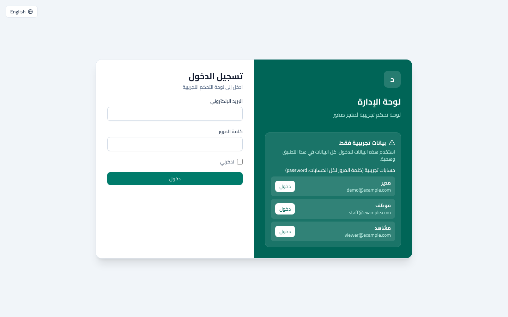
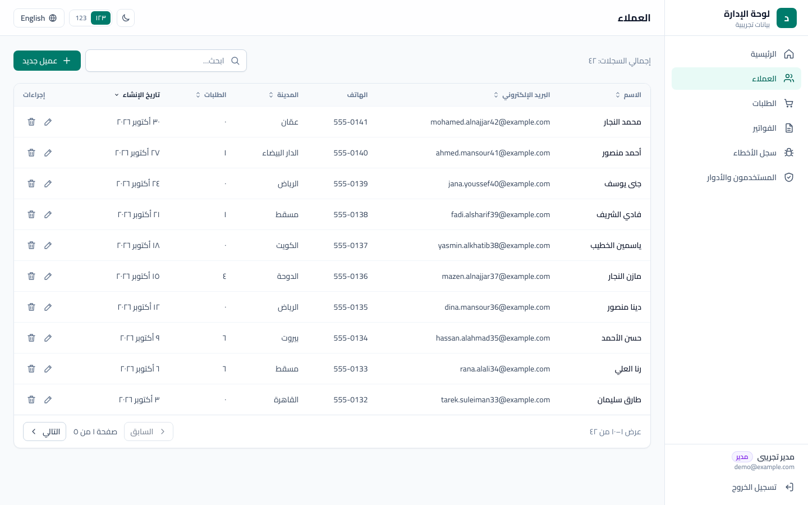
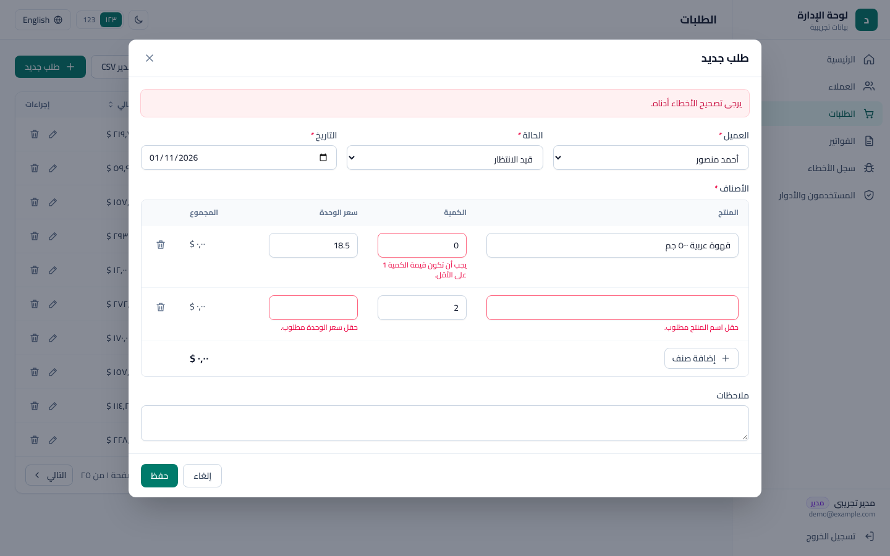
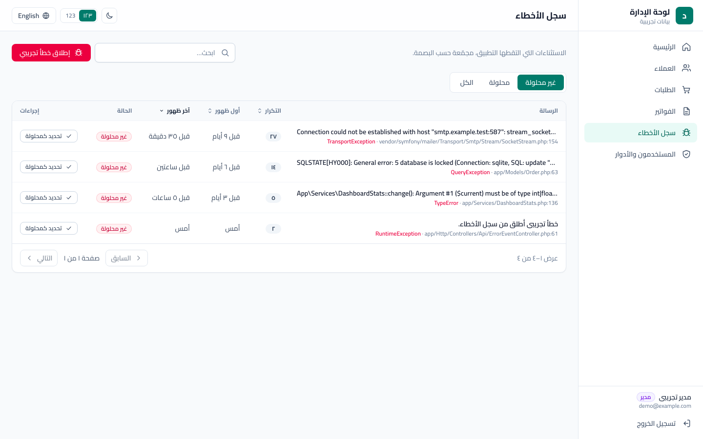
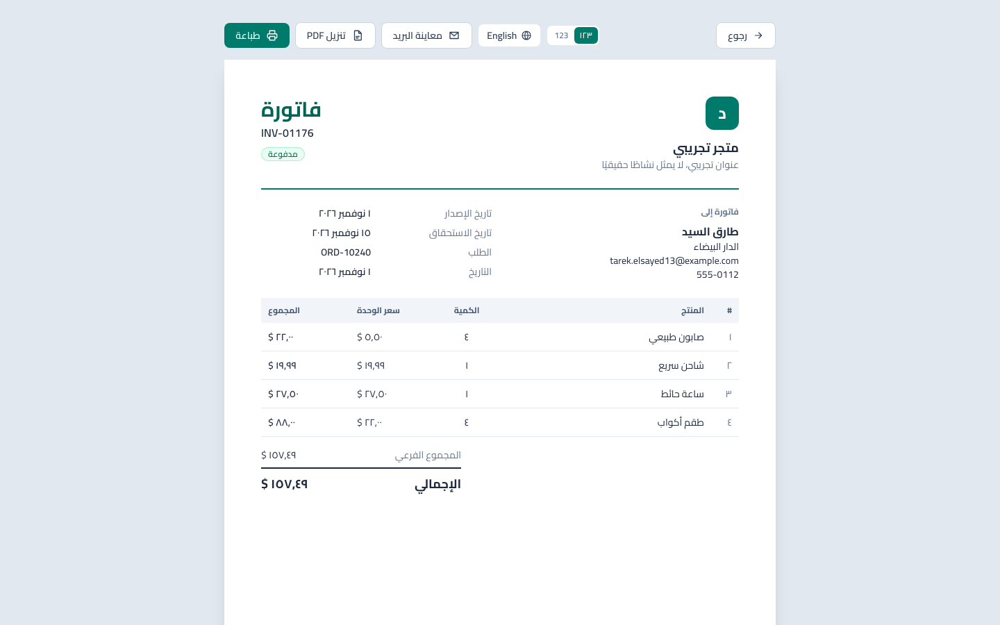
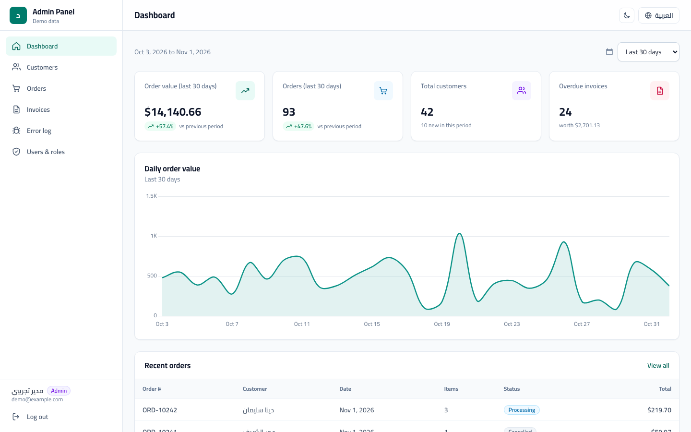
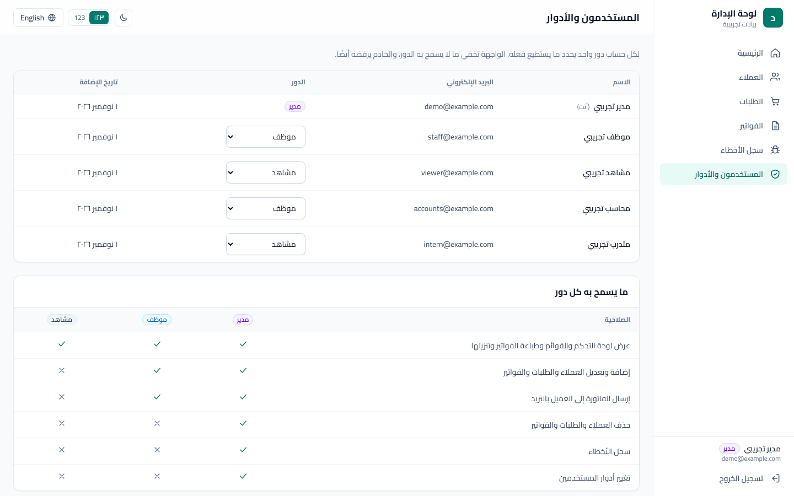

> **The initial data is fictional and seeded for this demo.** The app also accepts user input and records runtime exceptions; use fictional data when trying it. Demo logins: `demo@example.com` (admin), `staff@example.com`, `viewer@example.com`, password `password`.

# laravel-vue-rtl-admin-demo

## ملخص بالعربي

مشروع تجريبي للوحة تحكم لمتجر صغير. الواجهة عربي من اليمين للشمال، وفيها زرار يحوّلها إنجليزي. البيانات المبدئية وهمية ومتولدة تلقائيا. لو هتضيف بيانات للتجربة استخدم بيانات وهمية؛ التطبيق بيحفظ اللي بتدخله وبيسجل أخطاء التشغيل.

اللي موجود فيه:

- تسجيل دخول بثلاث أدوار: مدير وموظف ومشاهد. كل دور بيشوف ويعمل المسموح له بس، والسيرفر نفسه بيرفض أي طلب مش مسموح حتى لو اتبعت من برّه الواجهة.
- العملاء والطلبات والفواتير: بحث وترتيب وتقسيم صفحات، ورسائل الأخطاء بالعربي تحت كل خانة. البحث بيتجاهل فروق الهمزات والتاء المربوطة والألف المقصورة والتشكيل، يعني لو كتبت "احمد" هيلاقي "أحمد".
- صفحة رئيسية فيها أرقام ملخّصة ورسم لقيمة الطلبات اليومية (مجموع الطلبات غير الملغاة، مش الفلوس اللي اتحصّلت فعلًا).
- فاتورة للطباعة، وملف PDF بالعربي معمول على السيرفر، وإرسال الفاتورة للعميل بالإيميل (في النسخة التجريبية الإيميل بيتكتب في ملف السجلّ بدل ما يتبعت فعلًا).
- سجل أخطاء داخلي بيجمّع الأخطاء المتكررة، والمدير بس اللي يشوفه.
- نسخ احتياطي لقاعدة البيانات، وتشغيل بـ Docker، واختبارات تلقائية (Pest و Vitest)، وملف CI جاهز لـ GitHub Actions.

اللي مش موجود: مفيش دفع إلكتروني، ومفيش أكتر من شركة على نفس النظام، ولسه ما اتجربش على سيرفر حقيقي (VPS)؛ اتجرّب محليًا بس، والتفاصيل تحت.

للتجربة: ادخل بـ `demo@example.com` (مدير) أو `staff@example.com` (موظف) أو `viewer@example.com` (مشاهد)، وكلمة المرور لكلهم `password`.

---


An Arabic-first (RTL) admin dashboard for a small shop, with an English toggle. Laravel 12 API + Vue 3 single-page app in one repository.



## What it is / what it is not

**It is** a portfolio demo that shows how I build a right-to-left business UI end to end: session auth, CRUD with server-side validation in Arabic, a small analytics dashboard, a self-hosted error log, printable invoices, backups, tests and CI.

**It is not** a product, a template for a real business, or a copy of any existing app. There is no multi-tenancy and no payments; invoice emails go to the log mail driver, not a real inbox. Initial data comes from a deterministic seeder; subsequent user input and runtime errors are stored too.

## Features

- **Auth**: Sanctum SPA (cookie session) login and logout, demo credentials shown on the login page, login rate limits (5 attempts per minute per email + IP and 20 per minute per IP, Arabic 429 message), failed logins take a fixed minimum time (Laravel's built-in timebox, pinned by a test) so timing does not reveal which emails exist. Sending an invoice is limited to 5 per minute and 30 per hour per user, invoice PDFs and email previews to 20 per minute per user, and other API calls to 120 per minute per user.
- **Dashboard**: 4 KPI cards (order value and order count vs. the previous period, customers, overdue invoices), a daily order-value line chart, recent orders. *Order value* is the sum of non-cancelled orders by order date, invoiced or not; it is not collected revenue (that would be paid invoices).
- **CRUD** for customers, orders (with line items) and invoices (draft / paid / overdue):
  server-side search, sort and pagination; create/edit modals; server validation errors shown under each field (in Arabic by default, including per-item errors like `items.0.quantity`); delete confirmation; loading, empty and error states.
  Updates to orders and invoices re-read their state inside a transaction, locking the order before its invoice. SQLite uses a 5-second busy timeout and transactions with bounded retries. Laravel applies the configured `IMMEDIATE` mode on PHP 8.4 or newer; PHP 8.3 uses deferred transactions. MySQL/PostgreSQL use row locks. Only SQLite on local PHP 8.4 is exercised by the local test suite.
  Business rules: a customer with orders cannot be deleted, an invoice's amount and customer always come from its order, cancelled orders cannot be invoiced, an order with a paid invoice cannot be deleted and its items and customer are locked, draft invoices past their due date are marked overdue by a daily job. Search is Arabic-aware (ignores tashkeel and tatweel, treats أ/إ/آ as ا, ة as ه, ى/ئ as ي, ؤ as و, and Arabic-Indic digits as Latin) and treats `%` and `_` literally, and the CSV export neutralises spreadsheet formulas.
- **RTL done properly**: `dir="rtl"` by default, Tailwind logical utilities only (`ms-`, `ps-`, `start-`, `text-end`… a Vitest check fails CI on `ml-`, `left-`, `text-right` and friends), self-hosted Cairo font, Arabic-Indic or Latin digits (toggle, persisted), localized dates and relative times, mirrored icons and chart (time axis runs right to left, value axis on the right), ar/en toggle persisted in `localStorage`. Latin values (emails, phone numbers, `ORD-…`/`INV-…`) are bidi-isolated so they never get scrambled inside Arabic text.
- **Accessibility basics**: every form control has a label, server errors are linked to their field (`aria-invalid` + `aria-describedby`), dialogs trap focus and return it to the button that opened them, a skip link, keyboard-reachable error-log rows, a text summary for the order-value chart, and grey text bumped to colours that meet WCAG AA contrast on the light theme.
- **Error log ("Sentry-style", self-contained, no SDK)**: the exception handler records every reported exception into `error_events`, grouped by a fingerprint (class + file + line) with a counter, first/last seen and the last request. The page lists issues (unresolved / resolved / all), shows the stack trace with app frames highlighted, and lets you resolve or reopen. A resolved issue that happens again is reopened automatically. A "trigger test error" button and endpoint exist only when `APP_ENV=local`.
- **Ops**: `php artisan db:backup` (SQLite via `VACUUM INTO`; MySQL/MariaDB via `mysqldump` and PostgreSQL via `pg_dump`, whose command lines are covered by tests with a faked process but were not run against a live server here; keeps the newest 7) and `php artisan migrate:safe` (backup first, migrate only if the backup succeeded, no-op when nothing is pending). Scheduled backups and cleanup of old resolved errors.
- **Invoice print view**: A4 print stylesheet, RTL, uses the browser's print dialog.
- **Invoice PDF (server-side)**: rendered with mPDF, which shapes Arabic correctly (joined letters, right-to-left runs with Latin numbers inside); embeds a subset of the XB Riyaz font (SIL Open Font License, bundled with mPDF). Arabic or English depending on the UI language. Download link: `/documents/invoices/{id}.pdf`.
- **Invoice email**: RTL-safe HTML email (inline styles, table layout, bidi-isolated numbers) with the PDF attached. Staff and admins can send it; with the default `MAIL_MAILER=log` the full message is written to `storage/logs/laravel.log` instead of being delivered. Preview in the browser: `/documents/invoices/{id}/email`.
- **Extras**: dark mode (toggle, persisted, native controls follow it), period filter on the dashboard and the orders list (last 7 / 30 / 90 days or a custom range), and CSV export of the filtered orders (UTF-8 with BOM so spreadsheet apps open Arabic correctly).

## Stack

| Layer | Tools |
| --- | --- |
| Backend | PHP 8.3, Laravel 12, Sanctum (SPA cookie auth), SQLite by default |
| Frontend | Vue 3.5, TypeScript, Vite, Tailwind CSS 4, Pinia, vue-i18n, TanStack Query, Chart.js |
| Tests | Pest (feature + unit), Vitest + Vue Test Utils (jsdom) |
| Tooling | Playwright (screenshots), GitHub Actions CI, Docker (Apache + PHP 8.3 image, compose) |

## Setup

Requirements: PHP 8.3 or newer with `pdo_sqlite`, `mbstring` and `gd` (required by mPDF), Composer, Node 22.

```bash
git clone https://github.com/ZiadGamalDev/laravel-vue-rtl-admin-demo.git
cd laravel-vue-rtl-admin-demo
composer install
cp .env.example .env
php artisan key:generate
touch database/database.sqlite
php artisan migrate --seed
npm ci
npm run build
php artisan serve
```

Open **http://127.0.0.1:8000** and sign in with the demo login below. Use `127.0.0.1:8000` (the `APP_URL` in `.env.example`); Sanctum only treats the configured host as a first-party SPA.

For frontend development run `npm run dev` in a second terminal instead of `npm run build`.

To reset the data at any time: `php artisan migrate:fresh --seed`.

### Demo logins

All demo accounts use the password `password`. The login page has a one-click button for the first three.

| Email | Role | Can do |
| --- | --- | --- |
| `demo@example.com` | admin | everything, including the error log and changing user roles |
| `staff@example.com` | staff | create and edit customers, orders and invoices, email invoices; no deletes, no error log |
| `viewer@example.com` | viewer | read-only: dashboard, lists, invoice print and PDF, CSV export |
| `accounts@example.com` | staff | (extra seeded user for the Users screen) |
| `intern@example.com` | viewer | (extra seeded user for the Users screen) |

Roles are enforced on the server with Laravel policies (`app/Policies`); the UI only hides what the API would refuse anyway. New accounts default to `viewer`.

## API reference

`docs/openapi.yaml` (OpenAPI 3.1) documents every endpoint: auth flow, roles allowed per action, query parameters, request bodies, response shapes and error codes. Open it in any OpenAPI viewer (for example Swagger Editor or Redoc). A test (`tests/Unit/OpenApiTest.php`) fails if a route is added or removed without updating the file.

## Run with Docker

```bash
docker compose up -d --build
```

Open **http://localhost:8080**. The image is a single container (Apache + PHP 8.3, built frontend, `composer install --no-dev`). SQLite and a generated `APP_KEY` live in the `app-data` volume; the entrypoint runs migrations on every start and seeds the demo data only into an empty database while `DEMO_SEED=true`. Emails go to the container log (`docker compose logs app`). Stop and delete the data with `docker compose down -v`.

Building behind a TLS-inspecting proxy: pass its CA as a build secret, e.g. `docker build --secret id=extra_ca,src=proxy-ca.pem .`

**Docker verification limits:** the committed Dockerfile has not been verified end to end without modification. A prior Linux check used a verification-only variant with Composer dependencies installed outside the container because GitHub downloads were blocked inside it. That variant was used to check login, dashboard, PDF, email logging, headers and restart persistence. This does not establish that the published build command succeeds unchanged. Docker Desktop on macOS/Windows and a real VPS have not been tested.

## Deploy to a VPS

A minimal path, using the Docker setup above. It has been checked locally as described, **not on a real VPS**, so treat it as a starting point.

1. On a fresh Linux server with Docker installed, clone the repository and set your own values in `docker-compose.yml`: `APP_URL`, `SANCTUM_STATEFUL_DOMAINS` (your domain), a fixed `APP_KEY` (`php artisan key:generate --show` locally) and `DEMO_SEED: "false"` unless you want the demo data.
2. `docker compose up -d --build`.
3. Put a reverse proxy with HTTPS in front (Caddy or nginx with Let's Encrypt) that forwards to port 8080, then set `SESSION_SECURE_COOKIE=true`, set `TRUSTED_PROXIES` to the proxy's address (for a proxy container on the same Docker network, the network's CIDR) and add HSTS at the proxy.
4. Back up the `app-data` volume (it holds the SQLite file); `php artisan db:backup` inside the container writes to `storage/app/backups`, which is not on the volume, so copy backups off the server.
5. Run the scheduler for backups, cleanup and overdue invoices, e.g. a host cron entry: `* * * * * docker compose -f /path/docker-compose.yml exec -T app php artisan schedule:run`.

For more than a handful of users, move to MySQL/PostgreSQL and a separate queue worker; SQLite in one container is fine for a demo or a very small team.

## Tests

```bash
./vendor/bin/pint --test # PHP code style
./vendor/bin/pest        # backend: auth, dashboard, CRUD, validation in Arabic, error log, backups
npm test                 # frontend: formatting, translations parity, RTL utility guard, components, print view
npm run typecheck        # vue-tsc
npm run build            # type-check + production build (what CI runs)
```

### Screenshots

```bash
npx playwright install chromium   # once
npm run screenshots
```

The script builds the frontend, seeds a throwaway SQLite database with the clock frozen at 2026-11-01 (`APP_DEMO_DATE`), serves the app, and writes the 1440×900 images below (eight screens) to `docs/screenshots/`. The frozen seed and clock make the content repeatable; font rendering and browser versions can still change image bytes.

## Screenshots

| | |
| --- | --- |
|  Login with one demo account per role |  Dashboard (Arabic, Arabic-Indic digits) |
|  Customers list |  Order form with server validation errors in Arabic |
|  Error log, grouped issues |  Invoice print view |
|  Same dashboard in English (LTR) |  Users and roles (admin only), with the permission matrix |

## Production checklist

Generic steps for running a Laravel app like this one in production. Nothing here is specific to a real deployment.

- [ ] `APP_ENV=production` and `APP_DEBUG=false` (debug pages leak config and stack traces). The "trigger test error" endpoint is disabled outside `APP_ENV=local`.
- [ ] Generate a fresh `APP_KEY` (`php artisan key:generate`); never reuse the one from development.
- [ ] Behind a reverse proxy or load balancer, set `TRUSTED_PROXIES` to its IP(s)/CIDR (comma separated). Without it every request appears to come from the proxy, so the per-IP login limit throttles all users together.
- [ ] Set `APP_URL` to the public URL and `SANCTUM_STATEFUL_DOMAINS` / `SESSION_DOMAIN` to match it, served over HTTPS with `SESSION_SECURE_COOKIE=true`.
- [ ] Log rotation: `LOG_STACK=daily` and `LOG_DAILY_DAYS=14` (or ship logs to your platform), `LOG_LEVEL=warning`.
- [ ] Scheduler: one cron entry, `* * * * * cd /path/to/app && php artisan schedule:run >> /dev/null 2>&1`. It runs:
  - `db:backup --keep=7` daily at 02:30 (keeps the last 7 backups),
  - `model:prune` daily at 03:00 (removes resolved error-log issues quiet for 30+ days),
  - `invoices:mark-overdue` daily at 00:10 (draft invoices past their due date become overdue),
  - `auth:clear-resets` weekly.
- [ ] Deploy migrations with `php artisan migrate:safe --force` (takes a backup first, aborts if the backup fails, skips both when nothing is pending).
- [ ] Copy backups off the server (`storage/app/backups` is local disk only) and test a restore now and then.
- [ ] Cache for speed: `php artisan config:cache route:cache view:cache event:cache`; `npm ci && npm run build`.
- [ ] Run a real queue worker (`QUEUE_CONNECTION=database` or `redis`) under a supervisor if you add queued jobs.
- [ ] Configure a real mailer (`MAIL_MAILER=smtp` or an API mailer, `MAIL_FROM_ADDRESS`) before sending invoices; the demo default `log` only writes emails to the log.
- [ ] Change or remove the seeded demo users; do not run `--seed` against production data.
- [ ] The PHP app does not set security headers. The included Apache configuration sets `X-Content-Type-Options: nosniff`, `Referrer-Policy: strict-origin-when-cross-origin` and `X-Frame-Options: SAMEORIGIN`. Add an appropriate Content-Security-Policy and HSTS at the HTTPS proxy; neither is supplied by that configuration.

## Project structure

```text
app/
  Casts/DateOnly.php                 plain YYYY-MM-DD date columns
  Console/Commands/                  BackupDatabase (db:backup), SafeMigrate (migrate:safe), MarkOverdueInvoices
  Enums/                             OrderStatus, InvoiceStatus
  Http/
    Controllers/Api/                 Auth, Dashboard, Customer, Order, Invoice, ErrorEvent
    Middleware/                      SetLocale (X-Locale header), LocalOnly
    Requests/ Resources/             validation rules, JSON shapes
  Models/                            Customer, Order, OrderItem, Invoice, ErrorEvent (prunable)
  Services/DashboardStats.php        KPIs, chart series, period comparison
  Support/ErrorRecorder.php          exception grouping for the error log
  Support/ListQuery.php              shared search / sort / paginate
bootstrap/app.php                    middleware, exception reporting hook
database/seeders/                    DemoDataSeeder (fixed random seed), DemoErrorSeeder
lang/ar, lang/en                     server messages (full Arabic validation file)
resources/
  css/app.css                        Tailwind 4 theme, RTL helpers, print CSS
  js/
    pages/                           one component per screen
    components/                      layout, tables, modals, forms, chart
    composables/                     useListQuery, useCrud, useFormat
    stores/                          ui (locale, digits, theme), auth, toast
    i18n/                            ar.ts, en.ts (typed, same keys)
    lib/                             api client, http, Intl formatting
  views/app.blade.php                SPA shell (lang="ar" dir="rtl")
routes/                              api.php, web.php (SPA catch-all), console.php (schedule)
scripts/screenshots.mjs              Playwright screenshot generator
docs/openapi.yaml                    API reference (OpenAPI 3.1)
Dockerfile, docker-compose.yml       single-container image, SQLite volume
docker/                              entrypoint and Apache hardening
tests/                               Pest feature and unit tests
.github/workflows/ci.yml             Pest, Vitest, type-check and build
```

## License

MIT, see [LICENSE](LICENSE).
